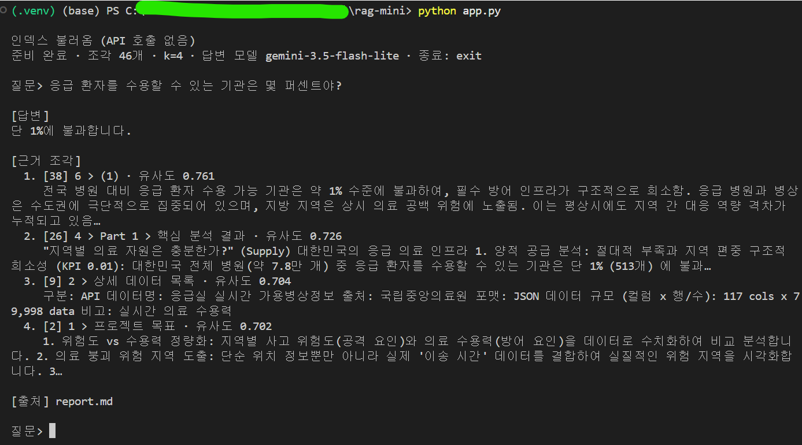
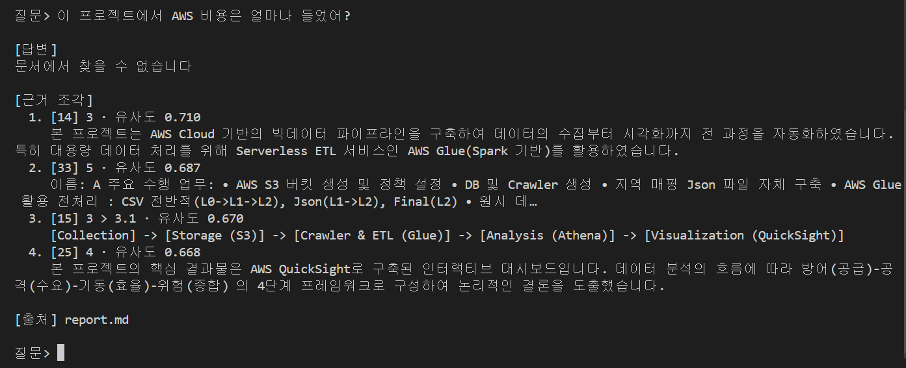
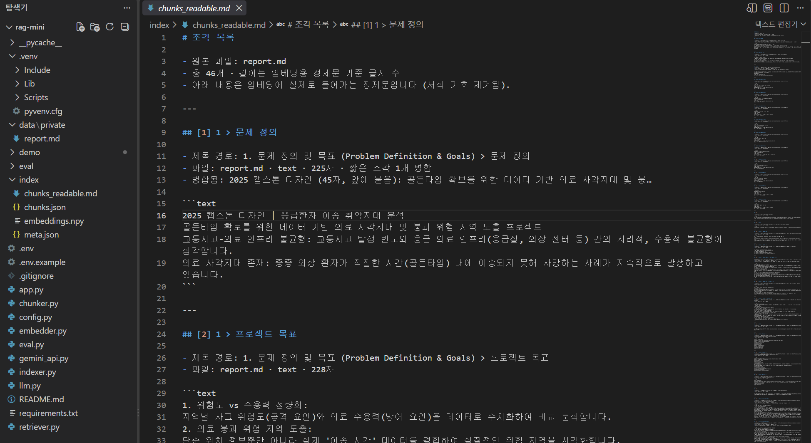

# rag-mini: 문서 근거 질의응답 CLI 챗봇

내 문서를 근거로 질문에 답하고, 답변과 함께 **근거 조각·유사도·출처 파일**을 보여 주는 작은 RAG(Retrieval-Augmented Generation) 프로젝트입니다.

## 1. 목적

- 문서에 있는 내용만으로 답하고, 문서에 없으면 "문서에서 찾을 수 없습니다"라고 답하는 챗봇을 만든다.
- 답변의 근거(어느 조각을, 얼마나 비슷하다고 판단해 가져왔는지)를 함께 보여 줘 사람이 검증할 수 있게 한다.
- 질문 20개로 직접 평가하고, 오답의 원인을 검색 단계와 생성 단계로 나눠 분석한다.

에이전트, 배포, UI, 벡터DB 서비스는 범위에서 제외했다. 벡터는 파일(`.npy`)에 저장하고 numpy로 코사인 유사도를 계산한다.

## 2. 처리 흐름과 폴더 구조

```
문서(.md/.txt) ─▶ 조각 나누기 ─▶ 조각 임베딩 ─▶ index/ 에 저장 (문서·설정이 바뀔 때만 다시 생성)
                                                   │
질문 ─▶ 질문 임베딩 ─▶ 코사인 유사도 상위 k개 ◀──────┘
                          │
                          ▼
        프롬프트(근거만으로 답하라) + 근거 + 질문 ─▶ 답변 생성
                          │
                          ▼
        출력: 답변 / 근거 조각(번호·제목 경로·유사도·내용 일부) / 출처 파일명
```

```
rag-mini/
├─ config.py        설정값 (모델, k, 조각 길이, 한도, 설정 버전)
├─ chunker.py       문서 → 조각 (API 호출 없음)
├─ gemini_api.py    Gemini 클라이언트, 429 구분, 재시도 (공통)
├─ embedder.py      조각·질문 임베딩, 묶음 전송과 대기
├─ indexer.py       조각+임베딩 저장/불러오기, 변경 감지
├─ retriever.py     코사인 유사도 상위 k개 검색
├─ llm.py           generate_answer() — LLM_PROVIDER 로 공급자 선택 (현재 gemini만 구현)
├─ app.py           CLI 질문 루프
├─ eval.py          평가 질문 일괄 실행 → CSV
├─ eval/            평가 질문(questions.tsv)과 결과
├─ data/private/    원본 문서 (git 제외)
├─ index/           조각·임베딩 파일 (자동 생성, git 제외)
├─ requirements.txt
└─ .env.example     API 키 이름 목록 (.env 는 git 제외)
```

| 라이브러리 | 이유 |
|---|---|
| `google-genai` | Gemini 공식 Python SDK (임베딩, 답변 생성) |
| `python-dotenv` | `.env`의 API 키를 코드에 적지 않고 환경변수로 불러오기 |
| `numpy` | 벡터 저장(.npy)과 코사인 유사도 계산 (벡터DB 대신) |

**설정 (v1)**

| 항목 | 값 |
|---|---|
| 조각 수 | 46 |
| 임베딩 모델 | `gemini-embedding-2` (768차원) |
| 답변 모델 | `gemini-3.5-flash-lite` |
| 검색 조각 수 k | 4 |
| temperature | 0 |
| 설정 버전 | v1 (`config.py`의 `SETTINGS_VERSION`) |

**무료 등급 한도 (AI Studio에서 직접 확인)**

| 모델 | RPM | TPM | RPD |
|---|---|---|---|
| `gemini-embedding-2` | 100 | 30K | 1K |
| `gemini-3.5-flash-lite` | 15 | 250K | 500 |

`gemini-3.6-flash`는 RPD가 20이라 평가를 반복할 수 없어서 쓰지 않았다.

## 3. 설치·실행법

Windows PowerShell 기준:

```powershell
python -m venv .venv
.venv\Scripts\activate
pip install -r requirements.txt
copy .env.example .env
```

`.env`를 열어 `.env.example`에 있는 키 이름에 값을 채운다.

| 키 이름 | 용도 |
|---|---|
| `GEMINI_API_KEY` | Gemini API 키 (필수) |
| `RAG_CLAUDE_KEY` | 나중에 Claude로 답변 생성할 때 사용 (현재 미구현) |
| `LLM_PROVIDER` | `gemini` (기본값) |

`.env`는 `.gitignore`에 들어 있어 커밋되지 않는다. Claude 키 이름은 `ANTHROPIC_API_KEY`를 쓰지 않는다(같은 이름의 환경변수가 다른 도구의 과금 방식에 영향을 줄 수 있어서).

문서는 `data/private/` 폴더에 넣는다(`.md`, `.txt`를 모두 읽음). 이 폴더는 저장소에 포함되지 않는다.

```powershell
python chunker.py           # (선택) 조각만 만들어 index/chunks_readable.md 로 검수
python indexer.py           # 임베딩 생성. 문서·설정이 그대로면 API 호출 없이 불러옴
python indexer.py --rebuild # 강제로 다시 생성
python app.py               # 질문 루프 (종료: exit)
python app.py --k 6         # 근거 조각 수 변경
python eval.py              # eval/questions.tsv 일괄 실행 → eval/results_*.csv
```

## 4. 조각 나누기 전략과 이유

| 규칙 | 이유 |
|---|---|
| 제목(`#`~`####`) 단위로 먼저 나누고, 조각마다 **제목 경로**를 저장 (예: `4 > Part 3 > 핵심 분석 결과`) | 이 문서는 "핵심 분석 결과"라는 같은 제목이 Part 1~4에 반복된다. 경로가 없으면 어느 Part의 내용인지 구별할 수 없다. |
| 800자를 넘는 섹션은 굵은 소제목 → 목록 항목·빈 줄 → 문장 순서로 경계를 찾아 자름 | 의미 단위(예: "1. 양적 공급 분석" 묶음)가 중간에 끊기지 않게 하려고 |
| 표는 **행 1개 + 헤더**를 한 조각으로 만들고, `헤더: 값` 형태로 정제 | 행 하나가 하나의 사실이라, 정답 위치를 조각 번호로 정확히 표시할 수 있다 |
| 임베딩 입력에서 `**`, `<br>`, `>` 같은 서식 기호 제거 | 서식 기호는 의미가 없고 유사도 계산에 잡음이 된다 |
| 짧은 일반 조각은 이웃 조각에 병합 (표 조각은 병합하지 않음). 병합으로 800자를 넘는 것은 허용 | 제목만 있는 조각이나 한두 줄짜리 조각이 검색 상위를 차지하지 않게 |
| 전체 조각을 `index/chunks_readable.md`로 저장 | 사람이 직접 조각을 검수하고 평가용 정답 위치(조각 번호)를 적기 위해 |

**최소 길이를 50자에서 80자로 올린 이유**

각 Part(1~4)에는 제목 아래에 질문 한 줄짜리 도입부(예: "지역별 의료 자원은 충분한가?")가 있다. 최소 길이가 50자일 때 Part 1 도입부(43자)는 다음 조각에 합쳐졌지만, Part 2~4 도입부(53~60자)는 기준을 겨우 넘어 **질문 한 줄만 있는 조각**으로 따로 남았다. 같은 구조인데 처리가 엇갈렸고, 내용 없는 짧은 조각이 검색 상위를 차지해 실제 내용 조각을 밀어낼 수 있었다. 80자로 올려 네 도입부가 모두 각자의 "핵심 분석 결과" 조각 앞에 합쳐지게 했다.

## 5. 평가 방법과 결과

**방법**

- 질문 20개: 단일 8, 수치 4, 종합 4, 함정(문서에 없는 내용) 4. 질문 1~20번은 모두 직접 만들었다. 정답 판정은 모두 직접 했다.
- 질문마다 정답이 있는 조각 번호(기대조각)를 미리 적어 두었다 (`eval/questions.tsv`).
- `eval.py`가 앱과 같은 방식(k=4)으로 실행해 답변, 검색된 조각 번호, 유사도를 CSV로 저장한다. 검색 적중(기대조각이 상위 k개에 있는지)만 기계적으로 표시한다.
- 답변의 정답 판정(정답/부분/오답)과 오답 원인은 사람이 직접 했다. LLM 채점은 쓰지 않았다.
- 결과 파일: `eval/results_v1_20261105_1354_judged.csv`

**결과 (설정 v1)**

| 항목 | 결과 |
|---|---|
| 정답 | **17 / 20 (85%)** |
| 오답 | 3 (1, 6, 16번) |
| 검색 적중 (하나 이상, 함정 제외 16개) | 15 / 16 |
| API 호출 / 소요 시간 | 40회 / 96초, 429 없음 |

| 유형 | 정답 |
|---|---|
| 수치 | 4 / 4 |
| 단일 | 7 / 8 |
| 종합 | 3 / 4 |
| 함정 | 3 / 4 |

**오답 원인**

| 번호 | 분류 | 내용 |
|---|---|---|
| 1 | 조각 분리 + 생성 누락 | 사용한 데이터를 일부만 말함. 기대조각이 12개인데 k=4라 구조적으로 다 가져올 수 없음 |
| 6 | 생성 실패 (과잉 거절) | 정답 조각은 2위로 검색됐지만 "찾을 수 없다"고 답함. 질문 설계도 애매함 |
| 16 | 검색 실패 (어휘 불일치 추정, 미확인) | 정답 조각을 가져오지 못함. 질문의 "사고 때문에/수용 문제로"와 문서의 "사고 부담형/수용 병목형"이 달라서로 추정 |

**관찰: 유사도 임계값으로는 거절을 처리하기 어려웠다**

문서 밖 질문의 1위 유사도가 0.683~0.721로, 문서 안 질문의 1위 유사도(최저 0.657)와 겹쳤다. 유사도 기준선을 정해 "모르면 거절"하게 만들 수 없어서, 임계값은 두지 않고 거절은 프롬프트("근거에 없으면 '문서에서 찾을 수 없습니다'라고만 답하라")로 처리했다.

### 데모



문서 안 질문 (응급 환자를 수용할 수 있는 기관은 몇 퍼센트야?). 답변과 함께 근거 조각, 유사도, 출처 파일이 표시된다. v1 설정(k=4)으로 실행한 화면.



문서에 없는 질문 (이 프로젝트에서 AWS 비용은 얼마나 들었어?). 근거가 없으면 '문서에서 찾을 수 없습니다'라고 거절한다. v1 설정(k=4)으로 실행한 화면.



전체 파일 구조와 index/chunks_readable.md(조각 검수 파일) 화면.

## 6. 겪은 문제와 해결

| 문제 | 해결 |
|---|---|
| `.gitignore` 파일명이 `.gitignre`(오타)라 무시 규칙이 전혀 적용되지 않음 | 첫 커밋 전에 발견해 이름을 고치고 `index/`를 추가. 이후 커밋마다 `git status`로 `.env`, `data/private/`, `index/`가 빠졌는지 확인 |
| 한국어 Windows에서 `pip install -r requirements.txt`가 한글 주석 때문에 cp949 디코딩 오류 | `requirements.txt` 주석을 영어로 변경. 코드의 파일 읽기·쓰기는 모두 `encoding="utf-8"` 명시 |
| `gemini-embedding-2`에 문장 목록을 그대로 넣으면 **임베딩 1개로 합쳐서** 반환 | 조각마다 `types.Content`로 감싸서 보내고, 보낸 개수와 받은 개수가 다르면 오류로 멈추게 함. 서로 다른 벡터 46개가 만들어진 것을 확인 |

## 7. 한계

- 표본이 20문항이라 1문항이 5%p이고, 이 수치로 일반 성능을 주장하기는 어렵다.
- 문서 1종, 조각 46개라 검색 대상이 작고 쉬운 조건이다.
- 문서 안에 요약(6.1)과 본문(Part 1~4)이 같은 내용을 반복해, 요약 조각이 본문 조각을 밀어내는 경우가 있다.
- 개발 중 시험 호출 4건이 평가 질문의 주제와 일부 겹쳤다. 그 결과를 보고 설정을 바꾸지는 않았다.
- 6번 질문은 설계 결함이 있다(문서에 없는 "Top 5"를 물어 거절과 부분 답변의 경계가 애매함).
- 429 분기(분당 한도는 재시도, 일일 한도는 즉시 중단)는 실제 한도에 걸린 적이 없어 실행해 보지 못했다.
- 답변 첫 줄에 "[근거 N]"이 노출되는 경우가 있다(8번).

## 8. 개선 후보 (시도하지 않음)

- 프롬프트에 "근거에 일부만 있으면 그 부분만 답하라" 같은 부분 정보 허용 문구 추가 (6번 과잉 거절 대응)
- k 증가 (1번처럼 근거가 여러 조각에 흩어진 종합 질문 대응)
- 질의 확장 (16번처럼 질문과 문서의 어휘가 다른 경우 대응)
- Claude API로 답변 생성 비교 (`llm.py`의 `LLM_PROVIDER` 분기 구조는 준비됨)

설정을 바꾸면 `SETTINGS_VERSION`을 v2로 올리고 같은 20문항으로 다시 평가해 v1과 비교한다.

## 9. 데이터 출처와 내 역할

- **문서:** 팀 캡스톤 보고서 1종 (공개 GitHub README). 원본 저장소: https://github.com/RhoAias12/hywu-2025-capstone-love119
- 팀원 이름은 A~D로 익명 처리되어 있다.
- **내 역할:** 원본 캡스톤 프로젝트에서는 보고서의 Part 1 시각화를 담당했다. 이 RAG 챗봇의 설계·구현·평가는 개인 프로젝트이다.
